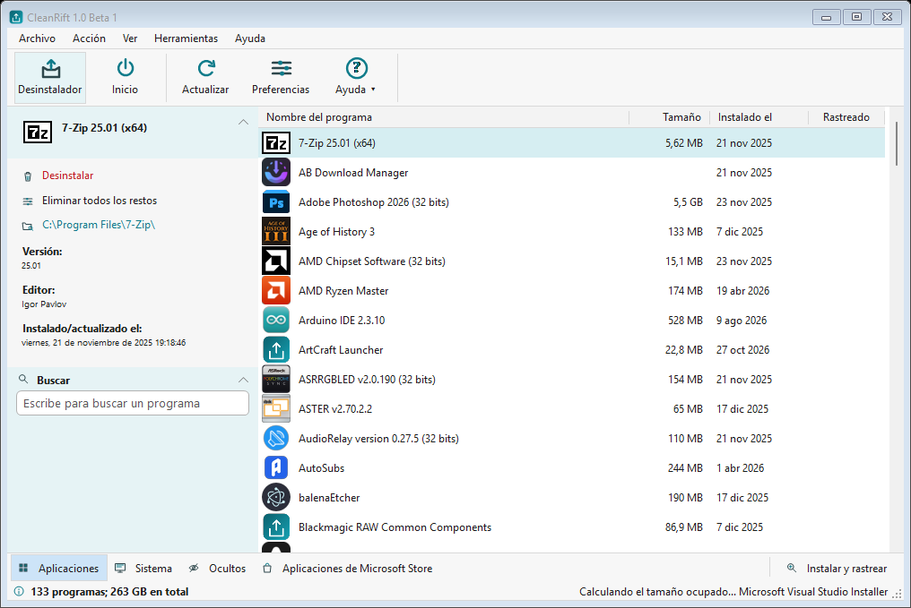

# CleanRift

**CleanRift 1.0 Beta 1** — a Windows uninstaller that removes programs, reviews
their leftovers, traces new installations and manages startup items.

CleanRift is an independent, open-source project released under the MIT License.
It is not affiliated with, endorsed by or sponsored by any third-party software
vendor.

> **Beta software.** Removal operations delete files and registry entries and
> cannot be undone by CleanRift. Back up important data before using Force
> Removal or the leftovers wizard.



## Status

This is the first public beta. The core workflows are implemented:

- Scan installed programs from the registry (32/64-bit), MSI installer data and
  Microsoft Store packages.
- Uninstall a program with its own uninstaller and review leftover files,
  folders and registry keys.
- Force removal, including batch force removal, with an explicit confirmation.
- Install and Trace: watch an installation in real time, fall back to snapshots
  when needed, and review the changes (see `docs/TRACKER.md`).
- Startup manager: Run/RunOnce keys, StartupApproved state and scheduled tasks.
- HTML export, themes (light/dark/auto), English and Spanish UI.
- Single instance, UAC elevation, optional SkipUAC scheduled task and jump list.

Known limitations are listed in [README.txt](src/CleanRift/README.txt) and
[docs/BETA.md](docs/BETA.md).

## Requirements

- Windows 10 or Windows 11, 64-bit.
- To build: .NET 9 SDK.
- The published portable build is self-contained and does not require a
  separate .NET installation.

## Build

```powershell
dotnet build CleanRift.sln -c Release
```

Create the portable package and, when Inno Setup is available, the installer:

```powershell
.\build.ps1
```

Outputs:

- `artifacts/release/CleanRift-1.0-beta1-portable/`
- `artifacts/release/CleanRift-1.0-beta1-portable.zip`
- `artifacts/release/CleanRift-1.0-beta1-setup.exe` (if `ISCC.exe` is found)

The language XML files are generated from `languages/english.csv` and
`languages/spanish.csv`:

```powershell
.\tools\Build-Languages.ps1
```

The application icon is generated from code:

```powershell
.\tools\Build-BrandAssets.ps1
```

## Run

Run `CleanRift.exe`. The app requests administrator rights because uninstallers,
the registry and protected folders require them.

Optional switches:

| Switch | Meaning |
| --- | --- |
| `/install_from_task_bar` | Open the Install and Trace page |
| `/startup_from_task_bar` | Open the Startup page |
| `/store_apps_from_task_bar` | Open the Microsoft Store page |
| `--job <file>` | Apply an elevated removal/startup job |

## Data and privacy

CleanRift stores settings, traces and cache in `%LOCALAPPDATA%\CleanRift`. It does
not send telemetry, does not contact a server and does not download updates.
See [docs/PRIVACY.md](docs/PRIVACY.md).

## Project layout

```
src/CleanRift/        WinForms application
tools/RenderForms/  diagnostic dialog renderer (not distributed)
tools/              language and icon generators
languages/          translation sources (CSV)
installer/          Inno Setup script
docs/               design, beta and privacy notes
```

## License

MIT. See [LICENSE](LICENSE).

“CleanRift” is a working name. Before a public launch, verify that the name and
domain do not conflict with existing trademarks in your jurisdiction. This
repository does not contain third-party artwork, icons or language files; the
icons are drawn by `tools/Build-BrandAssets.ps1` and `AppIcons.cs`.
