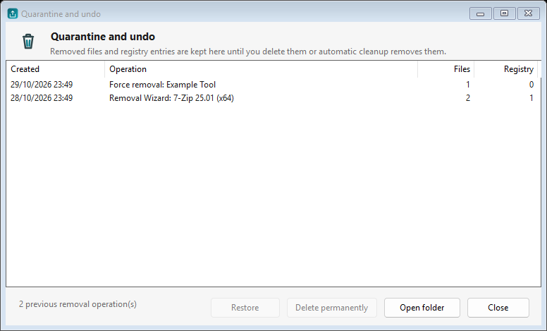
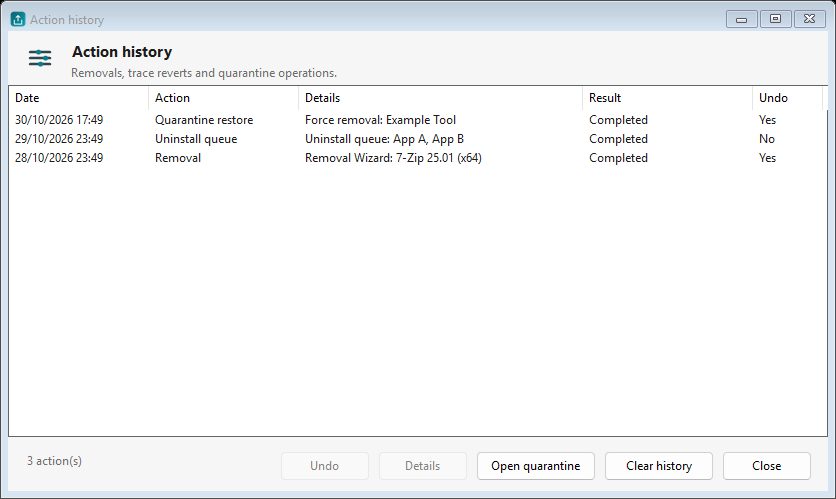
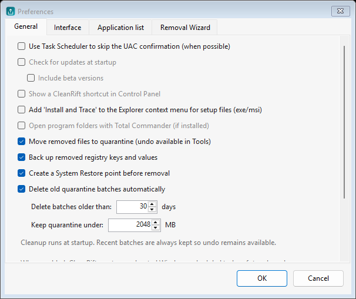

# CleanRift

**CleanRift 1.0 Beta 3.1** — a Windows uninstaller that removes programs, reviews
their leftovers, traces new installations and manages startup items.

CleanRift is an independent, open-source project released under the MIT License.
It is not affiliated with, endorsed by or sponsored by any third-party software
vendor.

[](https://github.com/iseaprojects/cleanrift/actions/workflows/build.yml)
[](https://github.com/iseaprojects/cleanrift/releases)
[](LICENSE)

> **Beta software.** Removal operations move files and registry entries to
> quarantine by default and can be restored from Tools → Quarantine and undo.
> Disable quarantine in Preferences if you want permanent deletion.

## Download

**Latest: [CleanRift 1.0 Beta 3.1](https://github.com/iseaprojects/cleanrift/releases/tag/v1.0.0-beta.3.1)** (beta)

- [Portable ZIP](https://github.com/iseaprojects/cleanrift/releases/download/v1.0.0-beta.3.1/CleanRift-1.0-beta3.1-portable.zip)
  — unzip and run `CleanRift.exe`; no installation required.
- [Installer](https://github.com/iseaprojects/cleanrift/releases/download/v1.0.0-beta.3.1/CleanRift-1.0-beta3.1-setup.exe)
  — per-user Inno Setup installer.
- [SHA-256 checksums](https://github.com/iseaprojects/cleanrift/releases/download/v1.0.0-beta.3.1/SHA256.txt).

Windows 10/11 x64. The executable is not code-signed yet, so Windows SmartScreen
may show a warning; verify the checksums above if you prefer.

## Screenshots


| Quarantine and undo | Action history |
| --- | --- |
|  |  |



Dark theme: [history](docs/screens/history-dark.png) ·
[quarantine](docs/screens/quarantine-dark.png).

## Status

This is the third public beta, with a small 3.1 patch. The core workflows are implemented:

- Scan installed programs from the registry (32/64-bit), MSI installer data and
  Microsoft Store packages.
- Uninstall a program with its own uninstaller, optionally silent.
- Uninstall queue for several programs, one after another.
- Review leftover files, folders and registry keys; Force Removal with explicit
  confirmation and a clear preview.
- Quarantine with undo, registry backups, optional System Restore points,
  automatic quarantine cleanup and an action history (see `docs/SAFETY.md`).
- Install and Trace: real-time filesystem and ETW registry monitoring, live
  event list and snapshot fallback (see `docs/TRACKER.md`).
- Startup manager with an estimated startup-impact column.
- Optional Explorer “Install and trace” context menu for setup files.
- HTML export, themes (light/dark/auto) and six UI languages: English,
  Spanish, French, German, Italian and Brazilian Portuguese.
- Single instance, UAC elevation, optional SkipUAC scheduled task and jump list.

Known limitations are listed in [README.txt](src/CleanRift/README.txt) and
[docs/BETA.md](docs/BETA.md).

## Requirements

- Windows 10 or Windows 11, 64-bit.
- To build: .NET 9 SDK.
- The published portable build is self-contained and does not require a
  separate .NET installation.

## Build

```powershell
dotnet build CleanRift.sln -c Release
```

Create the portable package and, when Inno Setup is available, the installer:

```powershell
.\build.ps1
```

Outputs:

- `artifacts/release/CleanRift-1.0-beta3.1-portable/`
- `artifacts/release/CleanRift-1.0-beta3.1-portable.zip`
- `artifacts/release/CleanRift-1.0-beta3.1-setup.exe` (if `ISCC.exe` is found)

The language XML files are generated from `languages/*.csv` (English, Spanish,
French, German, Italian and Brazilian Portuguese):

```powershell
.\tools\Build-Languages.ps1
```

The application icon is generated from code:

```powershell
.\tools\Build-BrandAssets.ps1
```

## Run

Run `CleanRift.exe`. The app requests administrator rights because uninstallers,
the registry and protected folders require them.

Optional switches:

| Switch | Meaning |
| --- | --- |
| `/install_from_task_bar` | Open the Install and Trace page |
| `/startup_from_task_bar` | Open the Startup page |
| `/store_apps_from_task_bar` | Open the Microsoft Store page |
| `/install_and_trace <setup>` | Open Install and Trace with a setup file |
| `--job <file>` | Apply an elevated removal/startup job |

## Data and privacy

CleanRift stores settings, traces, action history and quarantine data in
`%LOCALAPPDATA%\CleanRift`. It does not send telemetry, does not contact a
server and does not download updates. See [docs/PRIVACY.md](docs/PRIVACY.md).

## Verify a download

Each release includes `SHA256.txt`. Compare the downloaded file with PowerShell:

```powershell
Get-FileHash .\CleanRift-1.0-beta3.1-portable.zip -Algorithm SHA256
Get-FileHash .\CleanRift-1.0-beta3.1-setup.exe -Algorithm SHA256
```

## Contributing and security

Contributions are welcome; see [CONTRIBUTING.md](CONTRIBUTING.md). Please report
security issues privately through
[GitHub Security Advisories](https://github.com/iseaprojects/cleanrift/security/advisories/new)
instead of opening a public issue. See [SECURITY.md](SECURITY.md).

## Project layout

```
src/CleanRift/        WinForms application
tools/RenderForms/  diagnostic dialog renderer (not distributed)
tools/              language and icon generators
languages/          translation sources (CSV)
installer/          Inno Setup script
docs/               design, beta and privacy notes
```

## License

MIT. See [LICENSE](LICENSE).

“CleanRift” is a working name and has not been trademark-cleared. If you plan to
redistribute the project commercially, verify that the name and domain do not
conflict with existing trademarks in your jurisdiction. This repository does
not contain third-party artwork, icons or language files; the icons are drawn by
`tools/Build-BrandAssets.ps1` and `AppIcons.cs`.
